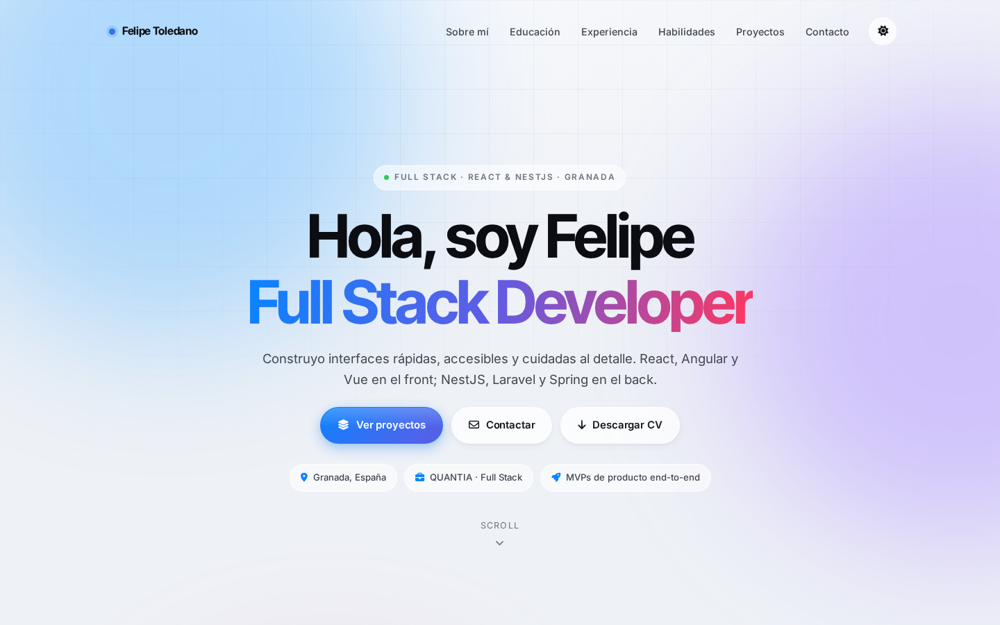

# Felipe Toledano — Portfolio

[](https://f3lip3x.github.io/Portfolio/)
[](./LICENSE)
[](https://github.com/F3LIP3X/Portfolio/commits/main)

Portafolio personal de **Felipe José Toledano Escudero**, desarrollador Full Stack en Granada, España.

**🔗 Sitio en vivo:** [f3lip3x.github.io/Portfolio](https://f3lip3x.github.io/Portfolio/)



## Sobre el proyecto

Landing page de una sola página construida con **React + Vite + TypeScript + Tailwind CSS**. Incluye tema claro/oscuro persistente, animaciones de entrada al hacer scroll, navegación con sección activa, filtro de habilidades por categoría y contadores animados.

## Stack

- **React 19** + **TypeScript**, empaquetado con **Vite**
- **Tailwind CSS** (configurado; el sistema de diseño "liquid glass" original se mantiene como CSS global en `src/index.css`)
- [Font Awesome](https://fontawesome.com/) para iconografía
- Fuentes [Inter / Inter Tight / JetBrains Mono](https://fonts.google.com/) vía Google Fonts

## Características

- 🌓 Tema claro/oscuro con detección de preferencia del sistema y persistencia en `localStorage`
- ✨ Animaciones de entrada (`IntersectionObserver`) y contadores numéricos animados
- 🧭 Navegación con resaltado de sección activa y barra de progreso de scroll
- 🔍 Filtro de habilidades por categoría (front-end, back-end, datos, herramientas)
- 📱 Totalmente responsive, con menú de navegación móvil
- ♿ Atributos ARIA y `alt` en imágenes para accesibilidad

## Estructura

```
Portfolio/
├── index.html                    # Entry HTML de Vite (metadatos SEO/OG)
├── src/
│   ├── main.tsx                   # Bootstrap de React
│   ├── App.tsx                     # Composición del layout (sin lógica propia)
│   ├── index.css                    # Tailwind + sistema de diseño ("liquid glass")
│   ├── components/                   # Un componente por sección/pieza de UI
│   │   ├── Ambient.tsx                 # Fondo decorativo (orbes)
│   │   ├── ScrollProgress.tsx           # Barra de progreso de scroll
│   │   ├── Nav.tsx                       # Navegación: tema, menú móvil, sección activa
│   │   ├── Hero.tsx, About.tsx, Education.tsx, Experience.tsx,
│   │   │   Skills.tsx, Projects.tsx, Contact.tsx, Footer.tsx
│   │   └── Stat.tsx                      # Contador animado reutilizable (usado en About)
│   └── hooks/                        # Lógica de interacción, cada una dueña de su estado
│       ├── useTheme.ts                 # Tema claro/oscuro + localStorage
│       ├── useActiveSection.ts          # Sección activa del nav + estado "scrolled"
│       ├── useScrollProgress.ts          # % de scroll para la barra de progreso
│       ├── useHeroParallax.ts             # Parallax del hero (vía ref, sin re-render)
│       ├── useCountUp.ts                   # Animación de conteo al entrar en viewport
│       └── useRevealOnScroll.ts             # Reveal-on-scroll + stagger (cross-cutting)
├── public/
│   ├── assets/                  # CV, fotos, logos de empresas/instituciones
│   ├── robots.txt
│   └── sitemap.xml
├── .github/workflows/deploy.yml   # Build + deploy automático a GitHub Pages
└── LICENSE
```

Cada pieza de estado vive en el componente o hook que la usa (p. ej. el filtro de
`Skills` es un `useState` local, el tema vive en `useTheme`); solo el reveal-on-scroll
y el stagger quedan en un hook a nivel de página porque son puramente decorativos y
no pertenecen a ningún componente en concreto.

## Desarrollo local

```bash
git clone https://github.com/F3LIP3X/Portfolio.git
cd Portfolio
npm install
npm run dev       # http://localhost:5173/Portfolio/
```

```bash
npm run build      # compila a dist/
npm run preview      # sirve dist/ localmente
```

## Despliegue

El sitio se publica automáticamente en **GitHub Pages** en cada push a `main` vía GitHub Actions (`.github/workflows/deploy.yml`), que compila con Vite y sube el resultado con `actions/deploy-pages`.

> **Configuración única necesaria:** en el repo de GitHub, ir a *Settings → Pages → Build and deployment → Source* y seleccionar **GitHub Actions** (en vez de "Deploy from a branch").

## Contacto

- 📧 [felitol2008@gmail.com](mailto:felitol2008@gmail.com)
- 💼 [LinkedIn](https://www.linkedin.com/in/felipe-toledano-escudero)
- 🐙 [GitHub](https://github.com/F3LIP3X)

## Licencia

Distribuido bajo licencia [MIT](./LICENSE).
